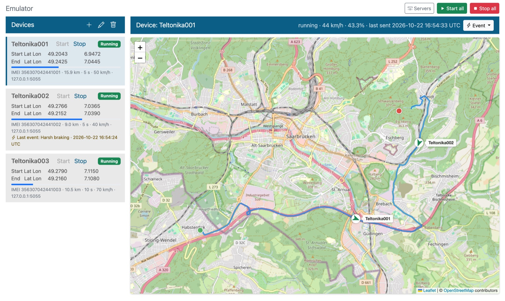
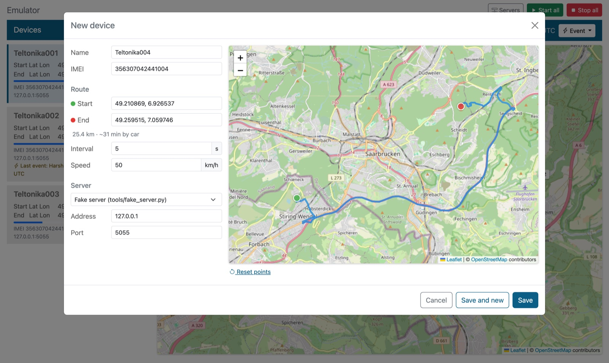
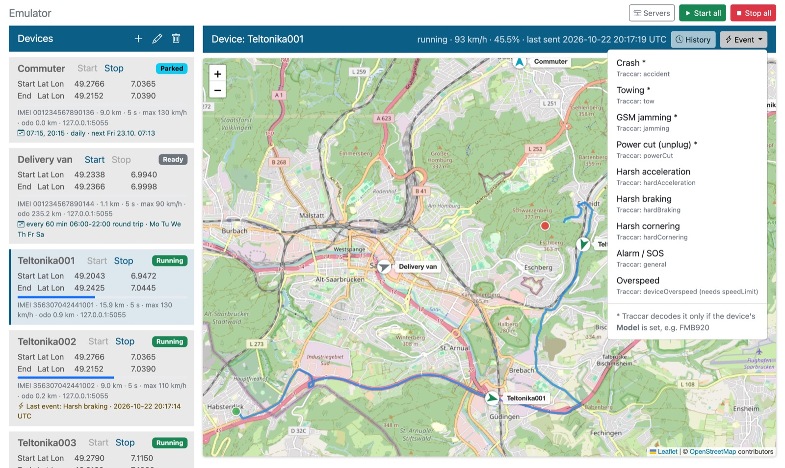
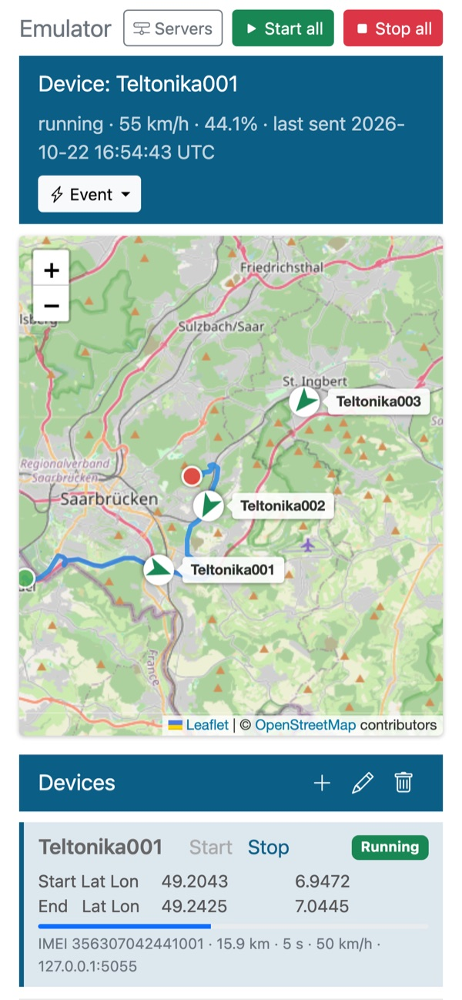
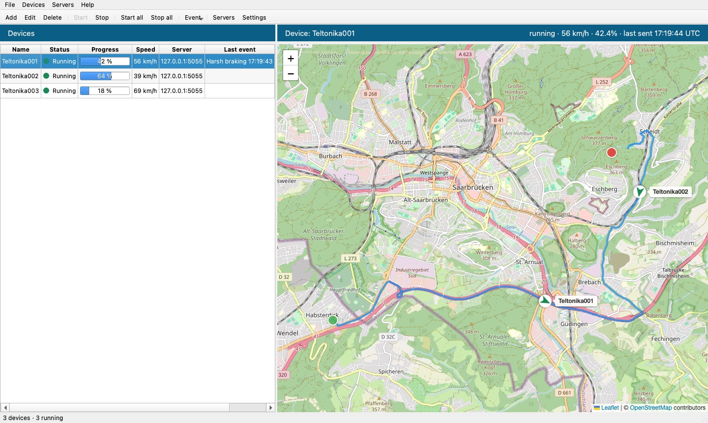
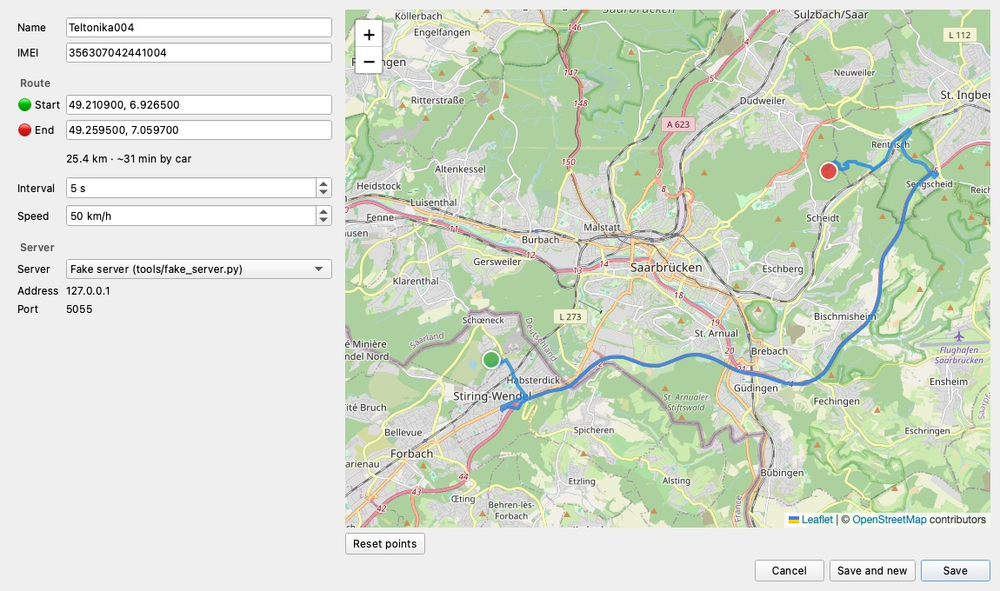

# MB GPS Emulator

A web app that emulates **Teltonika GPS trackers**. Pick a start and end point on a map,
get a real road route from GraphHopper, and let virtual devices drive along it while
they stream positions to **Traccar** (or any Teltonika-compatible server) using the
**Codec 8 AVL** protocol over TCP.

Built to test GPS tracking servers, alarms and notifications without real hardware or driving around.

It comes with two interfaces on top of the same core:

- **Web app:** runs in a browser, on desktop and iPhone. Easy to deploy with Docker.
- **Desktop app:** a native Qt window for macOS, Windows and Linux, with system notifications.

**Stack:** Python · Flask (web) · PySide6/Qt (desktop) · SQLite · vanilla JavaScript + Bootstrap 5 · Leaflet + OpenStreetMap · Docker



## Features

- **Devices:** add, edit and delete virtual trackers (name, IMEI, route, send interval, average speed, target server).
- **Routes:** click start and end on the map. The route comes from the GraphHopper Routing API and you can drag the markers to change it.
- **Emulation:** start or stop one device or all of them.
- **Scenarios:** let devices drive on a schedule, day after day, e.g. twice a day to work and back,
  every hour there and back, or back and forth all day. Between trips they stand parked with the
  ignition off.
- **History:** generate weeks or months of past data from a scenario in seconds. The records have
  realistic past timestamps and are sent like a tracker emptying its buffer, so you get a dataset
  for analytics right away.
- **Realistic data:** devices drive like real vehicles, so the data in Traccar can be used for analytics:
  - speeds follow the road (GraphHopper speed limits and road classes), with smooth acceleration and braking,
  - slower in curves and stops at traffic lights and junctions,
  - idling with ignition on before and after the trip,
  - GPS noise, satellites, HDOP and PDOP,
  - records saved like a Teltonika FMB: by time, heading change and speed change,
  - records are buffered while the server is offline and sent later.
- **Live map:** device markers update every 2 seconds. Works on desktop and iPhone.
- **Events:** send crash, towing, GSM jamming, power cut, harsh acceleration/braking/cornering, alarm/SOS or overspeed on demand, to test how your server reacts.
- **Servers:** manage a list of target servers (host + port).
- **Protocol:** real Teltonika Codec 8 over TCP, with IMEI handshake, CRC-16 and record acknowledgement. The encoder is verified byte-for-byte against the example in the Teltonika wiki.
- **Fake server:** a small built-in test server prints every decoded record, so you can try the emulator without Traccar.
- **Two UIs, one core:** the protocol, emulation, events and validation are shared by the web and desktop apps.

## Screenshots

| Add a device: click start and end on the map | Send an event from a running device |
|---|---|
|  |  |

<p align="center">
  <br>
  <em>On an iPhone</em>
</p>

## Quick start (Docker)

Requirements: Docker with the Compose plugin, and a free GraphHopper API key ([how to get one](#getting-a-free-graphhopper-api-key)).

```bash
git clone https://github.com/ffbmarcinbrodowski/mb_gps_emulator.git
cd mb_gps_emulator

cp .env.example .env
# edit .env and set GRAPHHOPPER_API_KEY=<your key>

docker compose up -d --build
```

Open `http://<docker-host-ip>:5057` in a browser on any device in your network.

Useful commands:

```bash
docker compose logs -f        # logs, including emulator output
docker compose down           # stop (data is kept)
git pull && docker compose up -d --build   # update
```

The database lives on the host in `./data/emulator.db`. To back it up, copy that file.

> **The server address `127.0.0.1` inside Docker means the container itself.**
> When you add a server in the emulator, use:
>
> | Traccar runs… | Host to enter |
> |---|---|
> | on the same machine as Docker | `host.docker.internal` |
> | on another machine | its IP or hostname, e.g. `192.168.1.20` |
> | the built-in fake server (see [below](#testing-without-traccar)) | `127.0.0.1`, port `5055` |

## Getting a free GraphHopper API key

1. Go to <https://www.graphhopper.com/> and click **Sign up**. An email and password are enough.
2. Confirm your email and log in to the dashboard at <https://graphhopper.com/dashboard/>.
3. Open **API Keys** and click **Add API Key**. Any description will do, e.g. `gps-emulator`.
4. Copy the key into `.env`:
   ```
   GRAPHHOPPER_API_KEY=your-key-here
   ```
5. Restart the container: `docker compose up -d`.

The free plan includes a limited number of requests per day. The emulator calls GraphHopper
only when you create a route, not while devices are driving, so the free plan is usually
enough for testing. Check GraphHopper's current pricing and terms for the exact limits and
allowed use.

## Usage

1. **Servers:** click **Servers** in the header and add your Traccar server. Teltonika's default port in Traccar is **5027**.
2. **Add a device:** click **+** in the *Devices* panel.
   - Enter a name and an IMEI (normally 15 digits), or click **Generate**. It creates a valid,
     unused IMEI from the test range `00…`, which is never assigned to real devices, so it can't
     clash with a real tracker on a shared server.
   - Click the map once for the **start** point and once more for the **end** point. The route appears automatically.
   - Set the interval (seconds between records while driving), the **max speed** of the vehicle
     (e.g. 130 for a car, 80 for a truck) and the server, then click **Save**.
   - **Realistic driving** is on by default. Switch it off for a simple constant-speed drive,
     which is handy for quick protocol tests.
   - **Scenario:** *Manual* drives the route once. Click **Edit…** next to *Scenario* to drive on a
     schedule instead (see [Scenarios](#scenarios)). The scenario window shows the next departures.
3. Click **Start** on a device, or **Start all**.
4. **Events:** select a running device and use **Event ▾** in the map header.

Device status: **Ready** (not started) · **Running** · **Paused** (stopped halfway; Start resumes) · **Finished** (Start drives the route again).

## Scenarios

A device with a scenario is **armed** when you click **Start**. It parks at one end of the route
and drives at the planned times until you click **Stop**.

| Scenario | Example | Settings |
|---|---|---|
| **Fixed times** | to work at 07:30, home at 16:30, Mon–Fri | departure times, days |
| **Every N minutes** | every hour 06:00–22:00, there and back | interval, active hours, round trip, wait at the end, days |
| **Back and forth continuously** | a shuttle 06:00–22:00 | active hours, wait at each end, days |

- **Direction:** every departure drives to the other end of the route (A → B, then B → A).
  A *round trip* always starts at A, waits at B and comes back.
- **Return route:** B → A has its own route from GraphHopper, because one-way streets and
  motorway exits differ. On the map it is the orange dashed line.
- **Parked:** between trips the vehicle stands with the ignition off and sends one record every
  5 minutes, like a parked Teltonika tracker. Events such as towing or power cut work while parked.
- **Random ±:** shifts each departure by a few minutes, so the vehicle doesn't leave to the second.
  The shift is fixed per device and departure, so the preview shows the real times.
- **Arming mid-day:** the vehicle is placed where the plan says it should be. For example, armed
  at 10:00 with a 07:30 departure, it stands at B and waits for 16:30. If a trip should be on its
  way right now, it leaves at once.
- **Restarts:** armed devices continue automatically when the app (or Docker container) starts
  again. **Stop** disarms them.
- **Time zone:** scenario times are local times of one time zone for the whole app:
  `EMULATOR_TIMEZONE` (Docker, e.g. `Europe/Berlin`), or *Settings* in the desktop app. Without
  either, the computer's zone is used.
- **Skipped departures:** a departure is skipped if the vehicle is still driving at that time.
  The preview warns when trips are longer than the gaps between departures.

## History

Analytics projects need weeks or months of data. **History** (map header in the web app, toolbar
in the desktop app) generates it from the device's scenario without waiting:

1. Give the device a scenario (e.g. *Fixed times* `07:30, 16:30`, Mon–Fri) and stop it.
2. Click **History**, choose how many days back (1–90) and click **Generate**.

- **Same models as live:** the scenario is simulated in virtual time with the same trips, traffic
  stops, idling, parking heartbeats, GPS noise and IO elements as live emulation.
- **Real timestamps:** every record gets the time it "happened", e.g. 07:31 three weeks ago. Only
  the upload is fast: records are sent in batches of 100, oldest first, like a tracker that was
  offline and empties its buffer.
- **Size and speed:** 90 days of a twice-a-day commute are about 72,000 records and take seconds.
  An hourly shuttle produces about a million records. Records are streamed, so memory use stays
  small. The upload speed depends on the server.
- **Reproducible:** the same device and period give the same history.
- **Continuity:** the device's odometer continues from where the history ended, and the device
  stands where the history left it.
- **Use a device with no data for that period** (e.g. a new IMEI). Otherwise old and generated
  tracks overlap.
- **Traccar** stores the records by their fix time, so reports (Trips, Stops, Summary) and
  analytics see them as normal history. The *server time* of each position is the upload time.

## Connecting to Traccar

1. In Traccar, add a device whose **Identifier** is the same IMEI as in the emulator.
   Traccar rejects unknown IMEIs, and the emulator then shows *"Server rejected IMEI"* under the device.
2. Point the emulator device at your Traccar server (port 5027) and click **Start**.

### Alarms from events

| Event | Teltonika IO = value | Traccar alarm |
|---|---|---|
| Crash \* | 247 = 1 | `accident` (the vehicle stops afterwards) |
| Towing \* | 246 = 1 | `tow` |
| GSM jamming \* | 249 = 1 | `jamming` |
| Power cut \* | 252 = 1 | `powerCut` |
| Harsh acceleration / braking / cornering | 253 = 1 / 2 / 3 | `hardAcceleration` / `hardBraking` / `hardCornering` |
| Alarm / SOS | 236 = 1 | `general` |
| Overspeed | 255 = speed | none from the IO. Traccar raises `deviceOverspeed` when the speed exceeds the device's `speedLimit` attribute. The vehicle speeds up to 130 km/h for 45 s, and the event record is sent once it is really that fast. |

\* Traccar decodes these only when the device's **Model** field (device settings → *Extra*) is set to a
Teltonika model such as `FMB920`. Without it, the value only appears as an attribute (`io247`, …).

To get notified, go to **Settings → Notifications → +**, choose type **Alarm**, select the alarms
(e.g. *Accident*) and a channel (e.g. *Web*), and tick **All Devices**.

## Desktop app



The desktop app has the same features as the web app (devices, route picker, servers, events)
in a native window. It adds system notifications when a route finishes or a connection fails,
and a tray icon with *Start all* / *Stop all*.

Requirements: Python 3.10+.

```bash
python3 -m venv .venv
source .venv/bin/activate          # Windows: .venv\Scripts\activate
pip install -r requirements-desktop.txt

python -m desktop
```

- **GraphHopper key:** enter it in **Settings…**. The `GRAPHHOPPER_API_KEY` environment variable and `graphhopper_api.txt` also work.
- **Data:** the desktop app keeps its own database in the user's app data folder (the path is shown in the status bar and in Settings), separate from the web app. Set `EMULATOR_DB` to use another file.
- **Internet:** the map (OpenStreetMap tiles, Leaflet) and route generation need an internet connection.

| Add / edit a device | |
|---|---|
|  | Click the map for the start and end point. The route is generated in the background and the markers can be dragged. |

## Running the web app without Docker

Requirements: Python 3.10+.

```bash
python3 -m venv .venv
source .venv/bin/activate          # Windows: .venv\Scripts\activate
pip install -r requirements.txt

export GRAPHHOPPER_API_KEY=your-key-here
python seed.py                      # optional: demo servers + 3 devices
python -m web                       # http://localhost:5057
```

Instead of the environment variable, you can put the key in a file named `graphhopper_api.txt`:

```
GRAPHHOPPER_API_KEY = 'your-key-here'
```

`seed.py` adds demo devices around Saarbrücken, Germany. It uses straight-line routes if GraphHopper is not configured.

## Testing without Traccar

`tools/fake_server.py` is a minimal Teltonika server. It accepts every IMEI, prints decoded records and sends proper acknowledgements:

```bash
python tools/fake_server.py                                  # local, port 5055
docker compose exec emulator python tools/fake_server.py     # inside the container
```

```
356307042441001 14:59:39  49.203869,6.948186    0 km/h  147°  alt 232 m  io {239: 1, 240: 0, 69: 1, 247: 1, 66: 12600, 16: 130}
    >>> EVENT: Crash (IO 247, priority 2)
```

## Configuration

| Variable | Default | Description |
|---|---|---|
| `GRAPHHOPPER_API_KEY` | – | GraphHopper API key (required for routing) |
| `GRAPHHOPPER_ROUTE_URL` | `https://graphhopper.com/api/1/route` | Routing endpoint; also works with a self-hosted GraphHopper |
| `EMULATOR_PORT` | `5057` | Web port |
| `EMULATOR_HOST` | `0.0.0.0` | Bind address |
| `EMULATOR_TIMEZONE` | the computer's zone (UTC in Docker) | Time zone of scenario times, e.g. `Europe/Berlin` |
| `EMULATOR_DB` | web: `./emulator.db` (Docker: `/data/emulator.db`), desktop: app data folder | SQLite database path |

More constants are in `config.py`: speed variation, TCP timeout and the routing profile.

## How it works

- Each running device has its own thread, which simulates the vehicle once per second (`core/motion.py`):
  - **Speed:** each road segment has a target speed. It is GraphHopper's average speed for the road (at least 80 % of the typical speed of the road class), capped by the speed limit and the device's max speed, with a small per-driver variation.
  - **Acceleration and braking:** the driver accelerates at up to 1.6 m/s². Looking ~500 m ahead, the driver brakes smoothly (about 2–3 m/s²) for curves, lower limits, stops and the end of the route.
  - **Curves:** curve speed comes from the curve radius (v = √(a·r) with 2.5 m/s² sideways), so a 90° junction turn is taken at ~25 km/h.
  - **Traffic stops:** random stops of 8–50 s, about 1 per km on town roads and rarer on faster roads. Sharp town turns often mean a stop.
  - **Ignition:** ignition on and 30–90 s idling before driving off, 15–45 s idling and ignition off at the destination.
  - **GPS:** slowly changing position error of ~2–5 m, varying satellites and HDOP. The position is frozen while standing ("static navigation", as on Teltonika).
- **Records** (`core/recorder.py`, modelled on Teltonika FMB data acquisition): while the ignition is on, a record is saved every *interval* seconds, on a heading change of ≥ 10° and on a speed change of ≥ 10 km/h. Every ignition change is an event record (IO 239).
- **Contents:** each AVL record has the timestamp, coordinates, altitude, heading, satellites and speed, plus these IO elements: ignition (239), movement (240), GNSS status (69), GSM signal (21), external voltage (66, ~14 V with the engine running and ~12.5 V off), PDOP/HDOP (181/182), total odometer (16, the device's lifetime distance) and trip odometer (199).
- **Offline buffer:** if the server is unreachable, the device keeps driving and buffers its records. They are sent in batches, with their original timestamps, when the connection is back, like a real tracker.
- **Old routes:** routes created before realistic driving have no road profile. Editing and saving such a device fetches it.
- The schema is created by SQL migrations in `core/migrations/`. They run automatically on startup.
- The web app polls the API every 2 seconds. In the desktop app, the emulator threads send a Qt signal on every change, so the table and map update immediately.

Teltonika Codec 8 over TCP:

```
device → server : [2B length][IMEI]
server → device : 0x01 accepted / 0x00 rejected
device → server : [4B zero][4B length][0x08][N][AVL records][N][4B CRC-16/IBM]
server → device : [4B number of accepted records]
```

## REST API

| Method | Endpoint | Description |
|---|---|---|
| GET, POST | `/api/servers` | List / create `{name, host, port}` |
| GET, PUT, DELETE | `/api/servers/<id>` | Read / update / delete |
| GET, POST | `/api/devices` | List / create a device |
| GET, PUT, DELETE | `/api/devices/<id>` | Read (incl. route points) / update / delete |
| POST | `/api/routes` | `{start: [lat, lon], end: [lat, lon]}` → route preview |
| GET | `/api/routes/<id>` | Saved route |
| POST | `/api/emulator/start` | `{device_id: 1}` or `{all: true}` |
| POST | `/api/emulator/stop` | `{device_id: 1}` or `{all: true}` |
| GET | `/api/emulator/events` | Available events |
| POST | `/api/emulator/event` | `{device_id: 1, type: "crash"}` |
| GET | `/api/emulator/status` | IDs of running devices |
| POST | `/api/scenarios/preview` | `{scenario: {...}, duration_s: 1290}` → next departures + warnings |
| GET | `/api/settings` | `{timezone}` |
| POST | `/api/history` | `{device_id: 1, days: 7}` → start generating history |
| GET | `/api/history/<device_id>` | `{state, progress, sent, period, error}` |
| POST | `/api/history/<device_id>/cancel` | stop generating |

## Project structure

```
core/                 shared core, no UI code
  config.py           settings (env variables / graphhopper_api.txt)
  database.py         SQLite connection + migration runner
  migrations/         SQL schema migrations
  models.py           SQL for servers, devices, routes
  services.py         validation + create/update/delete (used by both UIs)
  teltonika.py        Codec 8 encoder/decoder, CRC-16/IBM
  tcp_client.py       TCP client: IMEI handshake, send, acknowledgement
  geo.py              distance, bearing, interpolation along the route
  graphhopper.py      route generation
  motion.py           realistic driving: speed profile, acceleration, curves, stops, GPS noise
  recorder.py         when a record is saved (Teltonika FMB data acquisition)
  scenarios.py        schedules: next departure, where the vehicle stands, preview
  history.py          past data: scenario simulated in virtual time, sent in batches
  events.py           event catalog (crash, towing, …)
  imei.py             valid test IMEIs for new devices
  engine.py           one thread per device: drive / park, records, offline buffer
web/                  web app: Flask REST API + HTML/CSS/JS      (python -m web)
desktop/              desktop app: PySide6 windows + Leaflet map  (python -m desktop)
seed.py               demo data
tools/fake_server.py  test server
tests/                unit tests (python -m unittest discover -s tests)
Dockerfile, docker-compose.yml
```

## Security

The web app has **no authentication**. Run it only in a trusted local network or behind a VPN or reverse proxy with authentication. Anyone who can open it can control devices and use your GraphHopper quota.

## License

[MIT](LICENSE): free to use, modify and distribute for any purpose.
